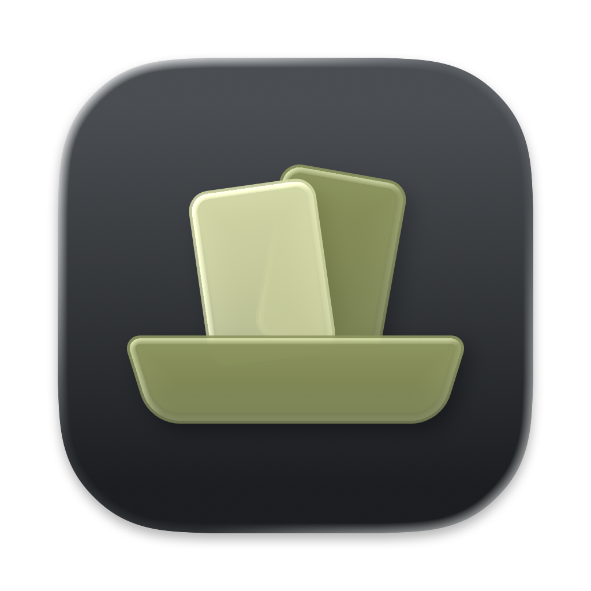
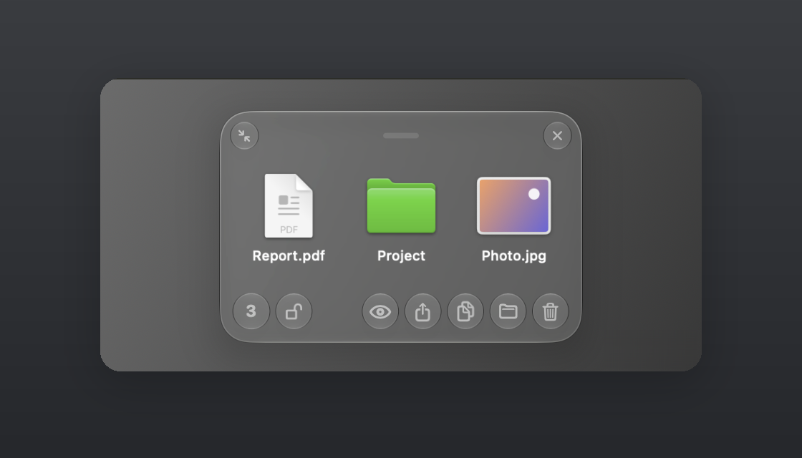
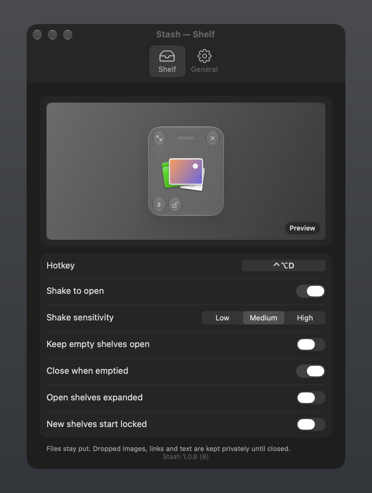
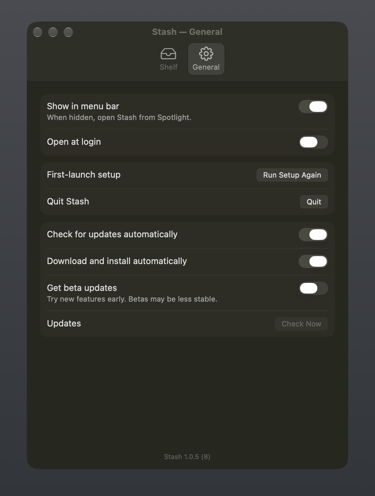
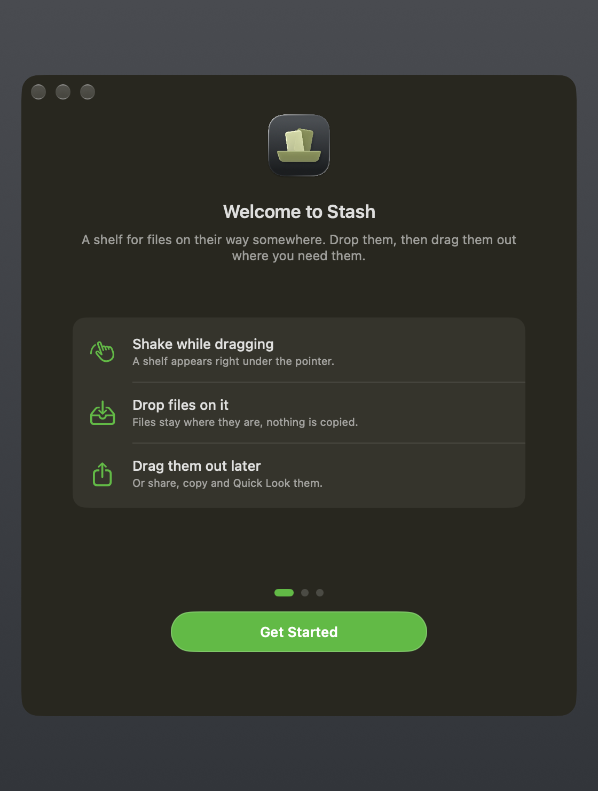
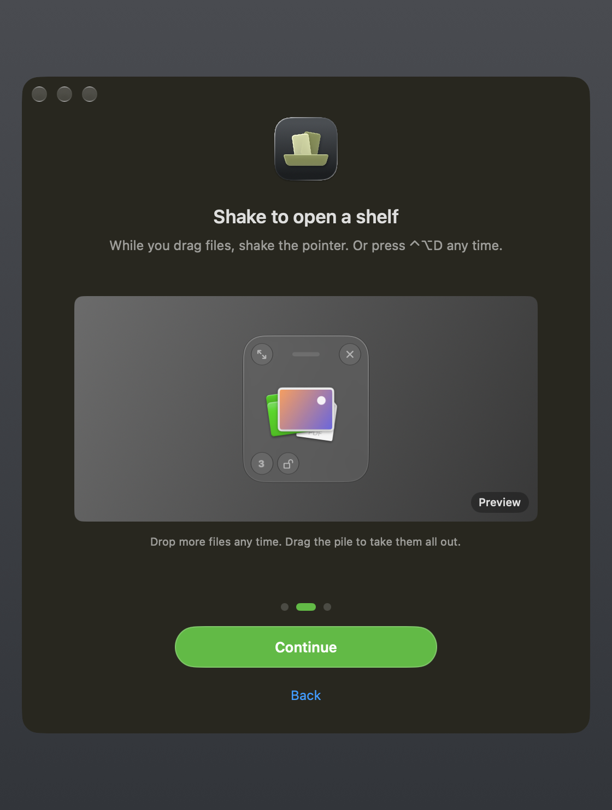
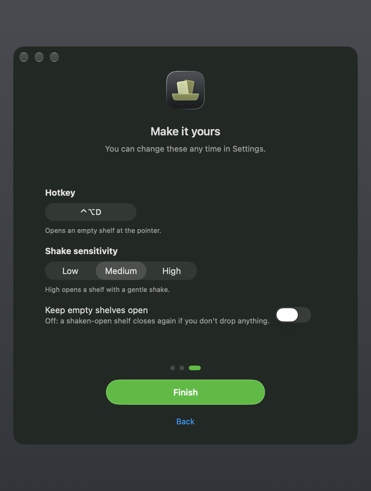

<p align="center">
  
</p>

<h1 align="center">Stash</h1>

<p align="center">
  A shelf for files on their way somewhere else.
</p>

<p align="center">
  <a href="https://github.com/0-LY/stash/releases/latest/download/Stash.dmg"><b>Download Stash for macOS</b></a>
  ·
  <a href="https://github.com/0-LY/stash/releases">All releases</a>
</p>

<p align="center">
  
</p>

## What it does

Start dragging files, shake the pointer, and a small shelf appears right there. Drop the files on it,
go find where they need to go, then drag them out again — all at once or one by one.

- **Open the shelf:** shake while dragging files — from Finder, the Dock's stacks or any app — or press the hotkey (⌃⌥D by default; click the Hotkey field in Settings and press your own keys) for an empty shelf at the pointer. Dragging a browser tab or a link never opens a shelf, and neither does moving a shelf itself. A shelf you open by shaking closes again if you don't drop anything on it; turn on **Keep empty shelves open** in Settings to keep it.
- **Small by default:** a shelf is a compact pile of what you dropped, with a count in the bottom-left corner. Drag the pile to take everything, or double-click it (or click ⤢) to expand. The shelf grows from its center and shrinks back; move it by the line at the top.
- **Pick what you need:** the expanded shelf shows every item. Click to select, ⌘-click to add or remove, Shift-click for a range, ⌘A for all, Esc to clear. Share, Copy, Show in Finder and Remove work on the selection, or on everything when nothing is selected. Dragging a selected item takes the whole selection. Drag the count at the bottom left to take the selection, or everything, out at once.
- **Preview:** press Space (or click the eye) for Quick Look on the selection — or on every file, newest first, when nothing is selected. Arrow keys step through files, Esc closes. Right-click a file for Quick Look, Open, Show in Finder, Copy and Remove.
- **Keyboard:** ⌘N new shelf, ⌘W close, ⌘A select all, ⌘C copy, ⌘⌫ remove, Return open, arrow keys move the selection (in the small pile they bring the next file to the top), ⌘, Settings. Click the count to select all.
- **Up to four shelves** at once, each with its own items, size and place. Move a shelf by dragging its top strip or any empty space.
- **Drop anything:** files and folders, images, links and text.
- **Take it out:** drag everything out at once from the pile or the item count, or a single item from its thumbnail. What you drag out leaves the shelf. Double-click an item to open it.
- **Lock a shelf:** click the lock next to the count, and the shelf keeps its files after you drag them out, so you can drag the same files out again and again. Turn on **New shelves start locked** in Settings to lock every new shelf.
- Items look the way they do in Finder: pictures and PDFs show a preview, everything else its icon.
- Shelves float above all windows and on every desktop, and close once everything has been dragged out (unless they are locked, or **Close when emptied** is off).
- Settings shows a live preview that follows your settings.

<p align="center">
  
  
</p>

## Install

> [!IMPORTANT]
> **First launch only.** Stash isn't notarized by Apple, so macOS blocks it the first time you open it.
> Click **Done**, open **System Settings → Privacy & Security**, scroll down, click **Open Anyway**
> next to "Stash", then open it again. You do this once; updates install and open normally.

1. [Download Stash.dmg](https://github.com/0-LY/stash/releases/latest/download/Stash.dmg) and open it.
2. Drag **Stash** onto the **Applications** folder in the window that opens.
3. Open Stash from Applications and use **Open Anyway** as above.
4. **First launch:** a short setup shows how to open a shelf (shake while dragging, or the hotkey) and lets you pick
   your hotkey and shake sensitivity — with a little confetti at the end.
   Skipped it? Everything from setup is also in Settings → Shelf (hotkey, shake, sensitivity, keep empty
   shelves). Run it again with **Run Setup Again** in Settings → General or **Set Up Stash…** in the
   menu — your current settings are kept.

<p align="center">
  
  
  
</p>

Stash needs no special permissions. Requirements: macOS 26 or later on Apple silicon.

To start Stash automatically, turn on **Open at login** in Settings → General. It's off until you turn it on.

## Privacy

- Nothing leaves your Mac unless you share it yourself.
- No account, no analytics, no tracking. The only network request is the update check.
- Files stay where they are; the shelf only keeps a reference to them.
- Images, links and text dropped without a file, and files that apps hand over on drop (Mail or chat attachments),
  are saved in a private temporary folder (readable only by you). They stay there until the shelf closes,
  so you can drag them out more than once, and are deleted when it closes and when Stash quits.
  They are always copied out, never linked.
- Files that apps hand over get macOS's "downloaded" mark, so Gatekeeper checks them before they run.
  Opening an app, script or link file from a shelf asks first.
- To detect a shake, Stash looks at the pointer position only while the mouse button is down
  and checks what kind of thing is being dragged (a file or not). It reads the content only when you drop it
  on a shelf. It never records keystrokes or what you click.
- Settings live in `~/.config/stash/`, readable only by you.
- Update checks fetch `https://github.com/0-LY/stash/releases/latest/download/appcast.xml`. No system profile is sent.

## Updates

Stash updates itself. Every update is signed, and Stash refuses any download whose signature doesn't match the key built into the app.

In **Settings → General** you can turn off automatic checks or automatic installs, check now, or switch on
**Get beta updates** to try new features early.

## Build from source

```sh
git clone https://github.com/0-LY/stash.git
cd stash
./build.sh                # installs to ~/Applications
./build.sh /Applications  # or another folder
```

You need the Xcode Command Line Tools (`xcode-select --install`). The first build downloads Sparkle
(pinned version, checked against its SHA-256).

| Path | Purpose |
|---|---|
| `Sources/main.swift` | App, menu bar, hotkey and shake wiring |
| `Sources/Shelf.swift` | The shelf: drop, drag out, share, temporary files |
| `Sources/Shake.swift` | Shake-while-dragging detection |
| `Sources/Settings.swift` | Settings window |
| `Sources/Config.swift` | Settings file |
| `Sources/Updates.swift` | Automatic updates (Sparkle) |
| `Resources/` | Info.plist template and entitlements |
| `app.env` | Name, publisher, GitHub owner and repo, version |
| `scripts/` | Build and Sparkle download scripts; `scripts/icon/` makes the app icon |

## Credits

Updates: [Sparkle](https://sparkle-project.org) (MIT).

## License

[MIT](LICENSE) © 0-LY
